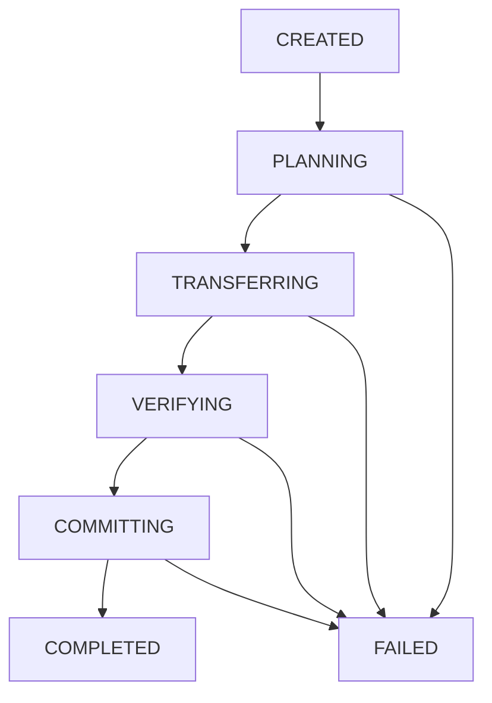

# UTP Transfer Lifecycle

A UTP Transfer operates as a strict state machine. This ensures that resuming an interrupted transfer is safe and idempotent. 

## Transfer States

1. **CREATED**: The transfer intent is recorded, but no provider interaction has occurred.
2. **PLANNING**: The engine queries provider capabilities (`stat()`) and generates a `ChunkPlan`.
3. **TRANSFERRING**: Chunks are actively being read, queued, and written to the destination.
4. **VERIFYING**: All chunks have been written. The engine validates the end-to-end cryptographic checksum.
5. **COMMITTING**: The destination provider finalizes the transfer (e.g., `CompleteMultipartUpload` in S3).
6. **COMPLETED**: The file is successfully stored and identical to the source.
7. **FAILED**: The transfer encountered a fatal error or exceeded retry limits and could not complete.

## Chunk States

Individual chunks within a transfer also follow a lifecycle:

- **PENDING**: Chunk is planned but not yet dispatched.
- **IN_PROGRESS**: Chunk is actively being written by a worker thread.
- **COMPLETE**: Chunk has been successfully acknowledged by the destination provider.
- **FAILED**: Chunk write failed permanently.

## State Transitions

<!-- Sequence diagrams verified -->
