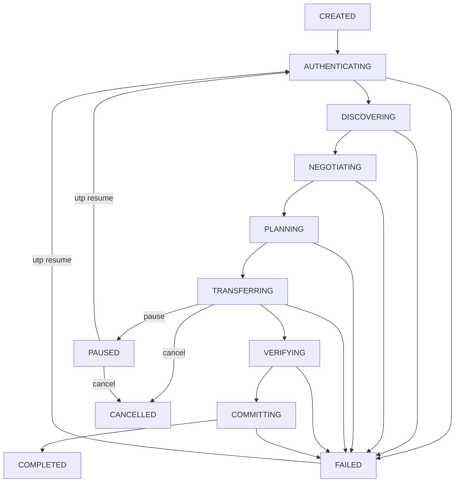

# UTP Transfer Lifecycle Specification

A UTP Transfer operates as an honest, fully observable state machine backed by an ACID SQLite ledger. This guarantees that transfers are resilient to crashes, network failures, and process terminations (`kill -9`), while enabling non-destructive pause and resume operations.

---

## 1. Transfer States

The engine progresses through an explicit, honest sequence of states:

| State | Description |
|---|---|
| **`CREATED`** | The transfer record is committed to the local ledger (`transfers` table) before any network calls or socket operations occur. |
| **`AUTHENTICATING`** | The engine verifies credentials, performs token validation, or refreshes expired OAuth2 tokens with the source and destination providers. |
| **`DISCOVERING`** | The engine queries source object metadata (`stat()`), resolving file size, directory structure, and remote capability flags. |
| **`NEGOTIATING`** | The engine queries destination capabilities, determines chunk constraints, and initializes the destination upload session (`openWrite()`). |
| **`PLANNING`** | Adaptive chunk planning (`ChunkPlanner`) computes chunk offsets and sizes. The initial plan is upserted into the `chunks` table. |
| **`TRANSFERRING`** | Worker threads actively stream, encrypt/decrypt, throttle, and transfer chunks between providers. |
| **`VERIFYING`** | All payload chunks have been transferred. The engine validates end-to-end cryptographic checksums (e.g., SHA-256) or verifies destination file size for empty files. |
| **`COMMITTING`** | The destination provider finalizes the upload session (e.g., `CompleteMultipartUpload` in S3, commit in Google Drive / Local). |
| **`COMPLETED`** | The transfer finished successfully and byte-identical. Destination artifacts are finalized and temporary files are promoted. |
| **`PAUSED`** | Transfer paused mid-flight (via atomic request or ledger `control = 'pause'`). Completed chunks and session tokens are preserved in SQLite. |
| **`CANCELLED`** | Transfer cancelled (via atomic request or ledger `control = 'cancel'`). Incomplete destination sessions are aborted (`abort()`), temporary artifacts removed, and resume is permanently refused. |
| **`FAILED`** | Transfer encountered an unrecoverable error or exhausted retries. The error message and HTTP status code are recorded; chunk progress is preserved for future `utp resume`. |

---

## 2. State Machine Diagram



---

## 3. The §7 Event Stream

Every state transition and milestone emits an event into the SQLite `events` table and triggers registered `EventCallback` listeners:

```cpp
enum class EventType {
    TRANSFER_CREATED,
    TRANSFER_AUTHENTICATING,
    TRANSFER_DISCOVERING,
    TRANSFER_NEGOTIATING,
    TRANSFER_PLANNING,
    TRANSFER_STARTED,      // Fresh transfer started
    TRANSFER_RESUMED,      // Interrupted/paused transfer resumed
    OBJECT_STARTED,
    CHUNK_ATTEMPTED,
    CHUNK_COMPLETED,
    CHUNK_FAILED,
    OBJECT_COMPLETED,
    TRANSFER_VERIFIED,
    TRANSFER_COMMITTING,
    TRANSFER_COMPLETED,
    TRANSFER_PAUSED,
    TRANSFER_CANCELLED,
    TRANSFER_FAILED,
    SYNC_STARTED,
    SYNC_PLAN_READY,
    SYNC_ITEM_COMPLETED,
    SYNC_CONFLICT_RESOLVED,
    SYNC_COMPLETED,
    SYNC_FAILED
};
```

### Event Ledger Schema

```sql
CREATE TABLE IF NOT EXISTS events (
    event_id INTEGER PRIMARY KEY AUTOINCREMENT,
    transfer_id TEXT NOT NULL,
    timestamp INTEGER NOT NULL,
    event_type TEXT NOT NULL,
    message TEXT,
    chunk_index INTEGER,
    bytes_transferred INTEGER
);
CREATE INDEX IF NOT EXISTS idx_events_transfer ON events (transfer_id, timestamp);
```

---

## 4. Cross-Process Control (Pause & Cancel)

UTP supports concurrent, cross-process control through the SQLite ledger:

1. **Ledger Column**: The `transfers` table includes a `control` column (`NULL`, `'pause'`, or `'cancel'`).
2. **CLI Commands**:
   - `utp pause <id>`: Invokes `StateManager::request_control(id, "pause")`.
   - `utp cancel <id>`: Invokes `StateManager::request_control(id, "cancel")`.
   - `utp status <id>`: Displays transfer state, bytes completed, error codes, and recent event timeline.
   - `utp list`: Lists recent transfers with IDs, states, sizes, and paths.
3. **Engine Polling**: Between chunk writes, `Engine::worker_loop()` checks its atomic flags (`pause_requested_`, `cancel_requested_`) AND queries `state_mgr_.get_control(transfer_id)`.
4. **Pause Invariant**: Pausing gracefully yields the worker threads, flushes committed chunks to the DB, marks the transfer `PAUSED`, and leaves `.utp.tmp` files and session tokens intact for seamless resumption.
5. **Cancel Invariant**: Cancelling immediately calls `dest_->abort()`, removes temporary files, deletes session tokens from the ledger, sets the transfer state to `CANCELLED`, and emits `TRANSFER_CANCELLED`. Resuming a cancelled transfer is strictly rejected.

---

## 5. Sync Session & Item Lifecycle

Folder synchronization operations are coordinated by `SyncEngine` and recorded in dedicated SQLite ledger tables:

### Sync Ledger Schema

```sql
CREATE TABLE IF NOT EXISTS sync_sessions (
    sync_id TEXT PRIMARY KEY,
    src_uri TEXT NOT NULL,
    dst_uri TEXT NOT NULL,
    direction TEXT NOT NULL,
    conflict_policy TEXT NOT NULL,
    status TEXT NOT NULL,
    total_items INTEGER DEFAULT 0,
    created_at INTEGER NOT NULL,
    completed_at INTEGER
);

CREATE TABLE IF NOT EXISTS sync_items (
    sync_id TEXT NOT NULL,
    rel_path TEXT NOT NULL,
    action TEXT NOT NULL,
    status TEXT NOT NULL,
    bytes INTEGER DEFAULT 0,
    PRIMARY KEY (sync_id, rel_path)
);
```

### Sync Lifecycle Flow
1. **`SYNC_STARTED`**: Session initialized with source/dest URIs, direction (`UNIDIRECTIONAL` or `BIDIRECTIONAL`), and `ConflictPolicy`.
2. **Tree Discovery**: Recursive tree traversal reads metadata (`size`, `mtime`, `hash`) on both sides.
3. **Delta Planning**: Files evaluated against Delta rules; unchanged files set to `SKIP` (0 bytes). Conflicts resolved according to policy.
4. **`SYNC_PLAN_READY`**: Plan saved to `sync_sessions` and `sync_items`.
5. **Item Execution**: Each non-skipped file streamed via memory pipeline (`utp::Engine`).
6. **`SYNC_ITEM_COMPLETED`**: Item status updated in ledger.
7. **`SYNC_COMPLETED` / `SYNC_FAILED`**: Session status finalized in `sync_sessions` and emitted to event ledger.

